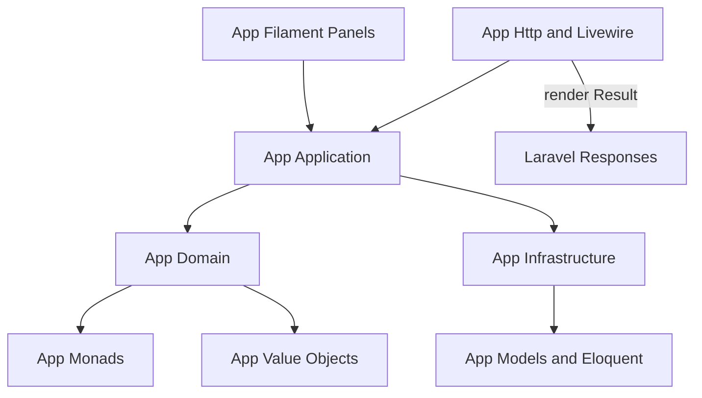

# Null Impossible Domain Architecture

This project uses a **Null Impossible Domain** architecture in the `App\` namespace. Expected absence and expected failure are modeled with custom monads, not nullable returns, sentinel values, or try/catch control flow.

## Overview

| Layer          | Namespace            | Responsibility                               |
| -------------- | -------------------- | -------------------------------------------- |
| Monads         | `App\Monads`         | `Option`, `Result`, `Unit` — framework-free  |
| Domain         | `App\Domain`         | Business rules, value objects, domain errors |
| Application    | `App\Application`    | Use cases, pipelines, orchestration          |
| Infrastructure | `App\Infrastructure` | Eloquent, repositories, framework adapters   |
| HTTP           | `App\Http`           | Middleware, responses, Livewire delivery     |
| Filament       | `App\Filament`       | Admin panels, resources, actions             |

Dependency direction flows inward: delivery layers call application use cases; application calls domain and infrastructure contracts; domain depends on nothing outside itself and monads.

## Layer Diagram

## Core Rules

1. **No nullable domain/application returns** — use `Option<T>` or `Result<T, E>`.
2. **No try/catch for expected failures** — use `Result` and `match()`.
3. **No abort in domain or application** — render at HTTP/Filament boundaries only.
4. **Strict types everywhere** — `declare(strict_types=1)` in every PHP file under `app/`.
5. **Fluid composition** — prefer Laravel Collections, Laravel Pipeline for DI stages, and PHP 8.5 `|>` for pure single-argument transforms.
6. **Filament is a delivery adapter** — resources delegate writes to application use cases.

## Documentation Index

- [Layers](layers.md) — namespace boundaries and allowed dependencies
- [Monads](monads.md) — `Option`, `Result`, `Unit` API and examples
- [Extended Monad Catalog](monad-catalog.md) — broader monad decision guide and adoption criteria
- [Error Model](error-model.md) — domain errors and boundary rendering
- [Pipelines and Pipes](pipelines-and-pipes.md) — Collections, Pipeline, native `|>`
- [Filament](filament.md) — admin panel integration guidance
- [Testing and Tooling](testing-and-tooling.md) — quality gates and tool ownership
- [Migration Guide](migration-guide.md) — converting existing nullable code
- [Current Project State](current-project-state.md) — architecture-relevant package and integration state

## Related Material

- R&D source: [docs/8000-r-and-d/monads-in-php/null-impossible-domain-architecture.md](../../8000-r-and-d/monads-in-php/null-impossible-domain-architecture.md)
- ADRs: [docs/adr/](../../adr/)
